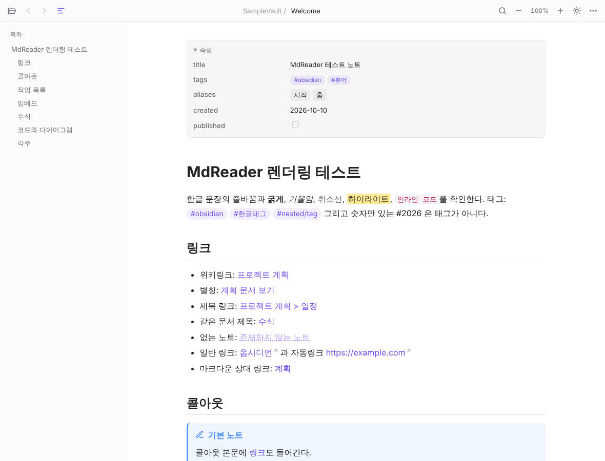
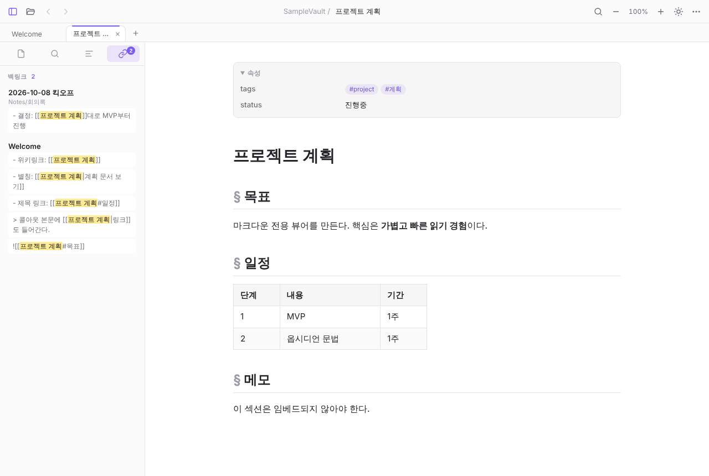
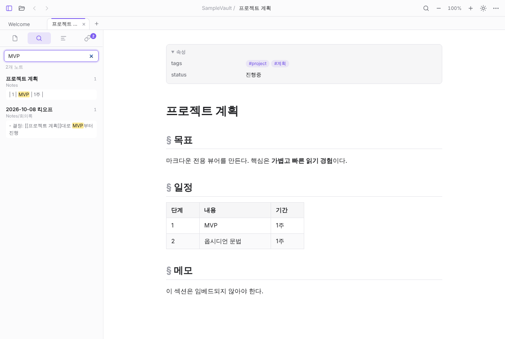
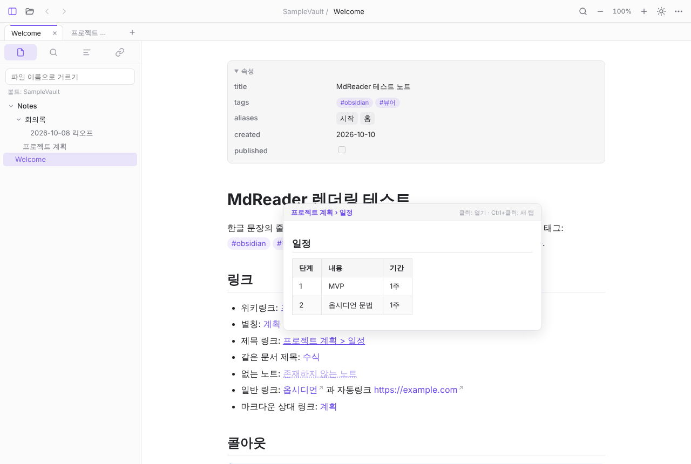
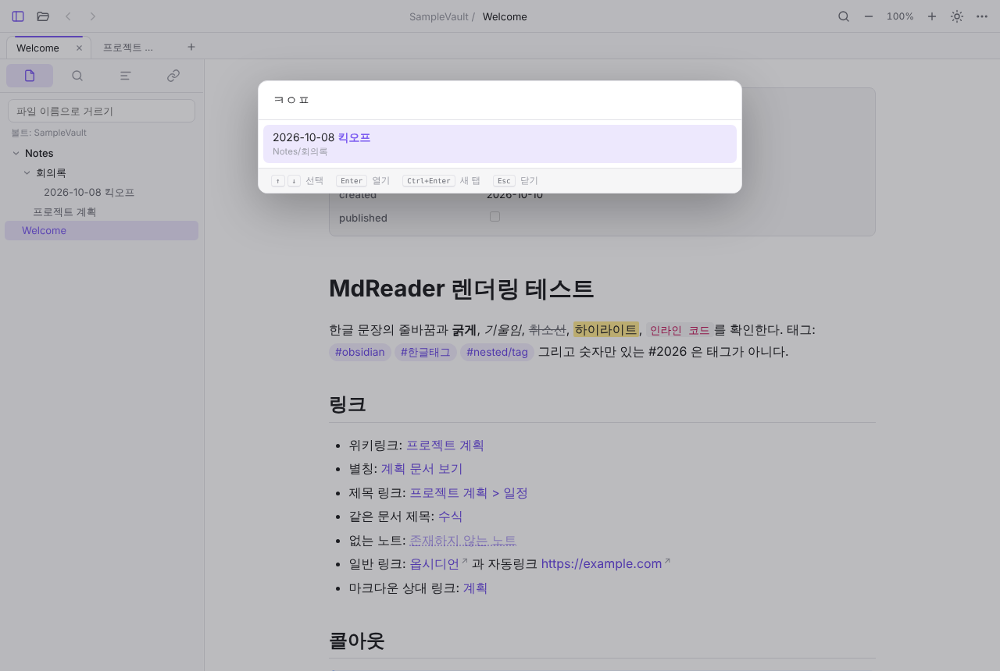
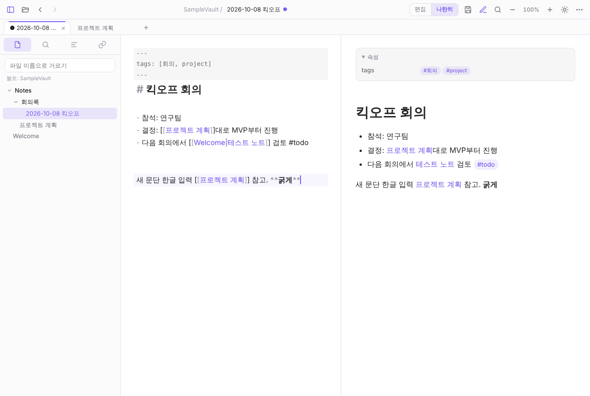

# 2. 개발 기록

2026-10-10 ~ 10-11, Claude와 대화하며 진행. 각 버전은 GitHub Actions(Windows)에서 빌드 확인.

## v0.1 — 1~3단계 (MVP + Obsidian 문법 + 읽기 편의)

- WPF + WebView2 호스트, markdown-it 기반 Obsidian 렌더러(`wwwroot/js/obsidian.js`)
- 위키링크·임베드·콜아웃·하이라이트·주석·태그·블록 ID·작업 목록·각주·수식·Mermaid·프론트매터
- 목차, 문서 내 찾기, 테마, 확대, 뒤로/앞으로, 자동 새로고침, 끌어다 놓기, 연결 프로그램 등록
- 렌더링은 헤드리스 Chromium(Playwright)으로 검증 — 샘플 볼트 `samples/SampleVault`

## v0.2 — 4단계 (탭·사이드바·스니펫·설치 프로그램)

- **탭·단일 창**: 탐색기에서 .md를 열면 기존 창의 새 탭으로 (Named Pipe), 세션 복원
- **사이드바**: 파일 트리 / 볼트 검색(`"구절"`, `#태그`, `file:`) / 목차 / 백링크
- **Obsidian CSS 스니펫** 적용 (Obsidian과 같은 CSS 변수·클래스 이름 사용)
- **Inno Setup 설치 프로그램** (관리자 권한 불필요, .NET 포함)
- GitHub 저장소 생성 후 첫 CI 빌드에서 C# 컴파일 처음 확인

## v0.3 — 읽기 경험

- **링크 미리보기**: 내부 링크에 마우스를 올리면 노트·제목 구간·그림을 팝업으로
- **빠른 이동 (Ctrl+P)**: 퍼지 검색 + **한글 초성 검색** (`ㅍㄹㅈㅌ` → 프로젝트 계획)
- **읽던 위치 기억** (파일별 최근 300개)
- 인쇄는 Ctrl+Shift+P로 이동

## v0.4 — 간단한 편집 모드 (A안)

"뷰어 정체성은 유지하고 빠른 수정만" 하는 A안으로 결정 (옵시디언식 라이브 프리뷰 B안은 제외).

- Ctrl+E 편집 / **나란히**(편집 + 실시간 미리보기), Ctrl+S 저장 — CodeMirror 6
- `[[` 노트 이름 자동완성, 서식 단축키, 찾기/바꾸기(한국어)
- 원래 인코딩·BOM·줄바꿈 유지, 임시 파일 경유 저장(원본 보호)
- 저장 안 한 변경이 있으면 이동·닫기 확인, Obsidian 등 바깥 변경 감지 시 선택 배너
- CodeMirror 번들은 작업 환경에서 npm이 막혀 **GitHub Actions(`vendor` 워크플로)에서 빌드**해 가져옴

## 배포 방식 정리

- 처음엔 Actions의 Artifacts로만 받을 수 있어 실행 파일을 찾기 어려웠음
- → `release` 브랜치에 올리면 **Releases 페이지에 설치 파일·포터블 zip 자동 게시**하도록 변경
- 첫 릴리스: [v0.4.0](https://github.com/sungsjang/MdReader/releases/tag/v0.4.0)

## 검증 한계 (솔직하게)

- 작업 환경(Linux)에서는 .NET·Windows를 직접 실행할 수 없어, C#은 **CI 컴파일 성공**까지만 확인
- 실제 Windows 화면 동작은 사용자 확인("다 잘 된다", v0.1·v0.2 기준)
- 실제 한글 IME 입력으로 편집기를 친 것은 미검증
