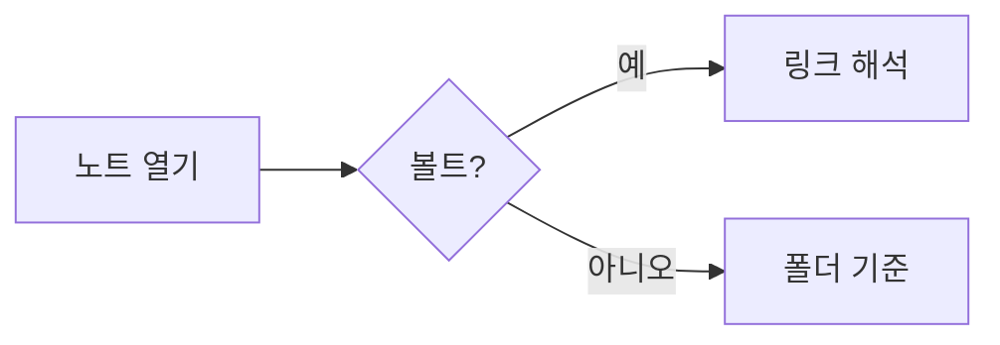

# MdReader 렌더링 테스트

한글 문장의 줄바꿈과 **굵게**, *기울임*, ~~취소선~~, ==하이라이트==, `인라인 코드`를 확인한다.%%이 주석은 보이면 안 됨%%
태그: #obsidian #한글태그 #nested/tag 그리고 숫자만 있는 #2026 은 태그가 아니다.

%%
여러 줄 주석
도 숨겨져야 한다
%%

## 링크

- 위키링크: [[프로젝트 계획]]
- 별칭: [[프로젝트 계획|계획 문서 보기]]
- 제목 링크: [[프로젝트 계획#일정]]
- 같은 문서 제목: [[#수식]]
- 없는 노트: [[존재하지 않는 노트]]
- 일반 링크: [옵시디언](https://obsidian.md) 과 자동링크 https://example.com
- 마크다운 상대 링크: [계획](Notes/프로젝트%20계획.md)

## 콜아웃

> [!note] 기본 노트
> 콜아웃 본문에 [[프로젝트 계획|링크]]도 들어간다.

> [!tip]+ 접을 수 있는 팁 (펼침)
> - 목록도 됨
> - `코드`도 됨

> [!warning]- 접힌 경고
> 숨겨진 내용

> [!question] 중첩
> > [!success] 안쪽 콜아웃
> > 잘 됨

> [!danger]
> 제목 없는 콜아웃

> 일반 인용문은 그대로.

## 작업 목록

- [ ] 할 일
- [x] 완료한 일
- [-] 취소
- 일반 항목

## 임베드

![[chart.png|320]]

![[프로젝트 계획#목표]]

![[프로젝트 계획#^goal-1]]

![[없는그림.png]]

## 수식

인라인 $E = mc^2$ 와 가격 $5 와 $10 은 수식이 아니다.

$$
\int_0^\infty e^{-x^2}\,dx = \frac{\sqrt{\pi}}{2}
$$

## 코드와 다이어그램

```python
def hello(name: str) -> str:
    return f"안녕, {name}"  # == 이건 하이라이트 아님 == %%주석 아님%%
```



```dataview
TABLE status FROM #project
```

## 각주

본문에 각주[^1]와 인라인 각주^[인라인 각주 내용]가 있다.

[^1]: 첫 번째 각주 내용.

<div style="color: tomato">HTML 블록</div><script>alert('xss')</script>

